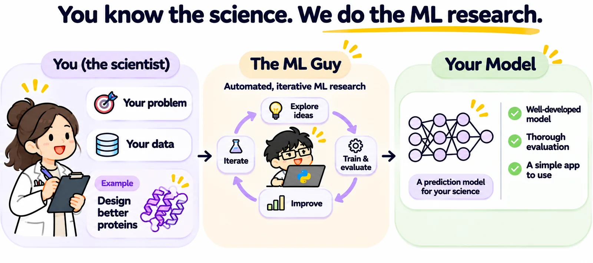

<p align="center">
  
</p>

# The-ML-Guy

Tell a coding agent what you want a model to do, and get back a trained model, an honest report
of how good it is, and a page to use it.

You describe the problem in your own words. The agent asks what it needs to know, agrees with
you how the model will be judged, and then builds and improves the model on its own. It works
with Claude Code or Codex, on your laptop or your cluster, whether or not you know machine
learning.

<p align="center">
  
</p>

## What it looks like

You write something like:

> I'm a hospitalist. Our care team can only call a fraction of the patients we discharge, and
> they pick by gut feel. I want a model that flags who is likely to be back within 30 days.
> diabetic_data.csv has about 100k encounters. It has to beat calling the people with the most
> prior admissions. Can you build that with The-ML-Guy?

The agent looks at your data, then asks a few questions, such as how many patients the team
can actually call. It shows you how the model will be tested and scored, on your own data, and
waits for your go-ahead. Then it builds and refines the model and comes back with:

- **a model** in `final/`, the exact one that was scored
- **a report**, `REPORT.md`: how good it is on data it never saw during building, what was tried,
  and what it cannot do
- **a page**, `app.py`, made for how you will use it

For that request, the model found 13% more of the patients who came back than the current rule,
for the same number of calls.

## Why you can trust the number

- **You agree how it is judged before anything is built.** Once you approve, the scoring is
  frozen, and the agent cannot change it.
- **A second agent tries to break the scoring first,** looking for ways to score well without
  solving your problem.
- **The final test is taken once.** That data stays out of the agent's reach until the end.
- **Failures are reported, not hidden.** A run that crashes is an error, not a zero, and the
  report says when nothing beat the starting point.

## Get started

```bash
git clone https://github.com/pengzhangzhi/The-ML-Guy.git && cd The-ML-Guy
pip install -e .
cp -r skills/* ~/.claude/skills/      # Claude Code; for Codex, see INSTALL.md
```

Then open Claude Code in a folder with your data and describe your problem. [INSTALL.md](INSTALL.md)
has the details, including Codex and a quick check that it works.

## Examples

[gallery/](gallery/) has five real problems, each with the request, the questions the agent
asked, and what came out:

| Problem | What came out |
| --- | --- |
| [Soluble protein design](gallery/proteinmpnn-solubility.md) | Half as many greasy surface residues, folds just as well |
| [Hospital readmission](gallery/diabetes-readmission.md) | 13% more returning patients found, same number of calls |
| [Cell types across platforms](gallery/pancreas-cell-types.md) | 0.94 across 13 cell types on an unseen platform |
| [Pathology image tiles](gallery/pathology-tiles.md) | 93% correct on later patients |
| [Brighter GFP variants](gallery/gfp-brightness.md) | 93 of the top 100 picks are bright, against 14 by hand |

Read the one closest to your problem before writing yours.

## Good to know

- **It is early.** It has been run end to end by Claude Code and Codex on the problems above.
- **There is no sandbox.** The agent runs with your permissions, like any coding-agent session.
  The test data is protected against accidents, not against an agent that goes looking for it.
- **Compute is yours.** The agent learns your machine (GPUs, a Slurm cluster, where files should
  go) and asks you which account to charge and how much it may spend.

How it works underneath: [DESIGN.md](DESIGN.md).

## Licence

MIT.
